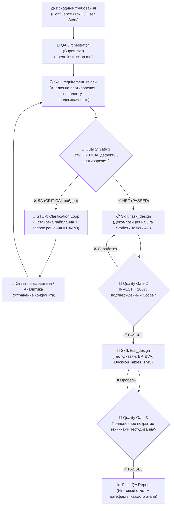

# AI QA Pipeline: Agent Instruction & Modular Skills

Комплексное решение для автоматизации процессов QA-инженерии с использованием LLM-агента и модульных навыков (Skills) на базе паттернов проектирования промптов, надежных агентных пайплайнов (*Fail-Fast, Human-in-the-Loop, Scope Integrity*) и подготовки к мультиагентной архитектуре.

---

## 📌 Архитектура пайплайна и Quality Gates

Агент работает по модели **Оркестратор / Супервизор — Модульные Скиллы (с поддержкой декомпозиции на воркеров)** с жестким контролем качества перехода между этапами и контуром обратной связи с человеком (*Clarification Loop*):



---

## 📂 Структура репозитория

```text
├── README.md                           # Общее описание проекта, архитектура и руководство
├── agent_instruction.md                # Главная системная инструкция агента (Scope, Tools, Failure Behaviour)
├── scripts/                            # Вспомогательные скрипты автоматизации
│   └── jira_fetcher.py                 # Скрипт интеграции с Jira Server REST API
├── skills/                             # Каталог специализированных навыков (Skills)
│   ├── requirement_review/
│   │   └── SKILL.md                    # Скилл анализа требований, Quality Gate 1 и Clarification Loop
│   ├── task_design/
│   │   └── SKILL.md                    # Скилл декомпозиции Jira, защита скоупа и Completion Criteria
│   ├── test_design/
│   │   └── SKILL.md                    # Скилл проектирования тестов (BVA, EP) и Completion Criteria
│   ├── test-data-factory/
│   │   └── SKILL.md                    # Скилл генерации реалистичных тестовых данных (РФ идентификаторы, security)
│   └── api-payload-generator/
│       └── SKILL.md                    # Скилл генерации cURL, фаззинга JSON и Postman коллекций
├── templates/                          # Шаблоны артефактов для стандартизации вывода
│   ├── requirement_review_template.md  # Шаблон отчета ревью требований
│   ├── jira_tasks_template.md          # Шаблон оформления задач Jira
│   ├── tms_test_suite_template.md      # Шаблон тест-кейсов для TMS (TestIT / Allure / TestRail)
│   └── final_qa_report_template.md     # Шаблон сводного отчета
└── examples/                           # Сквозной практический пример с отработкой Quality Gates
    ├── confluence_input_sample.md      # Входные требования из Confluence (конфликт 8 vs 10 символов)
    ├── step1_requirement_review.md     # Шаг 1: Остановка на Gate 1 BLOCKED -> Human Input -> PASSED
    ├── step2_jira_tasks.md             # Шаг 2: Утвержденные задачи спринта (без выдуманных правил)
    ├── step3_test_design.md            # Шаг 3: Тест-кейсы BVA/EP под подтвержденную длину 10–32
    └── step4_final_summary_report.md   # Шаг 4: Консолидированный аудит-отчет обеспечения качества
```

---

## 🧠 Ключевые архитектурные паттерны и исправления

1. **Human-in-the-Loop & Бескомпромиссный Quality Gate 1 (Fail-Fast)**:
   - При обнаружении прямого логического противоречия (например, минимальная длина пароля 8 vs 10 символов) агент **не имеет права выбирать значение самостоятельно**.
   - Пайплайн принудительно переводится в статус `BLOCKED`, выполнение останавливается до получения явного подтверждения от пользователя/аналитика.
2. **Scope Integrity & Zero Hallucination Policy**:
   - Агенту строго запрещено трансформировать свои инженерные гипотезы (например: лимиты брутфорса «5 попыток / 15 минут», привязку к Redis) в задачи спринта для разработчиков.
   - Все неподтвержденные гипотезы оформляются исключительно как **исследовательские задачи (Spikes)** или технические рекомендации вне основного скоупа.
3. **Обоснованное покрытие тест-дизайном (Гибкость вместо жестких лимитов)**:
   - Устранено искусственное ограничение «строго 1 позитивный и 1–2 негативных на каждый AC».
   - Количество проверок определяется свойствами критерия приемки: анализ граничных значений (BVA) для числовых полей и длины строк, классы эквивалентности (EP) для наборов данных и таблицы решений.
4. **Стандартизация инструкции агента**:
   - Выделены разделы: **Scope** (границы ответственности и строгие запреты), **Tools** (контракты инструментов) и **Failure Behaviour** (поведение при сбоях Confluence, Jira, TMS API и сетевых ошибках 429/5xx).
5. **Критерии завершения (Completion Criteria)**:
   - В каждый скилл добавлен раздел `Completion Criteria` (DoD навыка), регламентирующий готовность артефакта к передаче следующему модулю.
6. **Готовность к мультиагентности (Multi-Agent Architecture)**:
   - Пайплайн готов к декомпозиции на роль Супервизора (Supervisor) и профильных субагентов (Requirements Reviewer, Task Architect, Test Designer).

---

## 🚀 Как запустить и протестировать сквозной флоу

1. Передайте системный промпт из [`agent_instruction.md`](agent_instruction.md) в целевую LLM.
2. Подключите модули из каталога [`skills/`](skills/).
3. Подайте на вход агенту требования из [`examples/confluence_input_sample.md`](examples/confluence_input_sample.md).
4. **Наблюдайте работу Clarification Loop**: агент зафиксирует статус `BLOCKED` на Шаге 1 и запросит подтверждение длины пароля перед тем, как перейти к декомпозиции задач в Jira и генерации тест-кейсов.