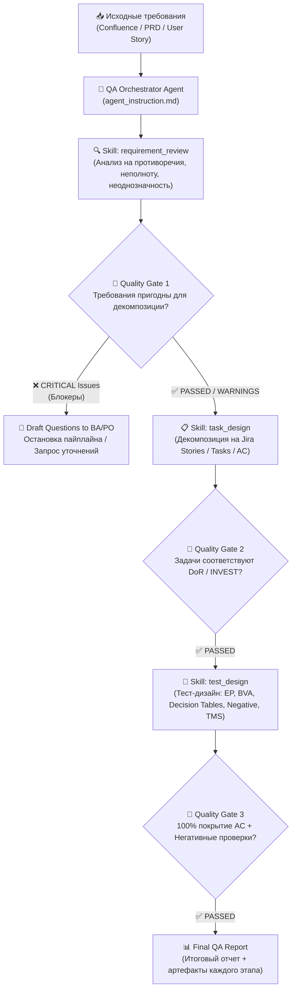

# AI QA Pipeline: Agent Instruction & Skills

Комплексное решение для автоматизации процессов QA-инженерии с использованием LLM-агента и модульных навыков (Skills) на базе паттернов проектирования промптов и агентных пайплайнов.

---

## 📌 Архитектура пайплайна

Агент работает по модели **Оркестратор — Модульные Скиллы (Orchestrator-Workers with Quality Gates)**:



---

## 📂 Структура репозитория

```text
├── README.md                           # Общее описание проекта, архитектура и инструкция
├── agent_instruction.md                # Главная системная инструкция агента-оркестратора
├── skills/                             # Каталог скиллов (навыков агента)
│   ├── requirement_review/
│   │   └── SKILL.md                    # Скилл анализа требований и проверки Quality Gate
│   ├── task_design/
│   │   └── SKILL.md                    # Скилл декомпозиции и проектирования Jira-задач
│   ├── test_design/
│   │   └── SKILL.md                    # Скилл проектирования тестовой модели для TMS
│   ├── test-data-factory/
│   │   └── SKILL.md                    # Скилл генерации тестовых данных (ИНН, СНИЛС, карты Луна, XSS, даты)
│   └── api-payload-generator/
│       └── SKILL.md                    # Скилл генерации cURL, фаззинга JSON и Postman коллекций
├── templates/                          # Шаблоны артефактов для стандартизации вывода
│   ├── requirement_review_template.md  # Шаблон отчета ревью требований
│   ├── jira_tasks_template.md          # Шаблон оформления задач Jira
│   ├── tms_test_suite_template.md      # Шаблон тест-кейсов для TMS (TestIT / Allure / TestRail)
│   └── final_qa_report_template.md     # Шаблон сводного отчета
└── examples/                           # Сквозной практический пример (End-to-End)
    ├── confluence_input_sample.md      # Входные требования из Confluence (фича "Смена пароля")
    ├── step1_requirement_review.md     # Результат работы Skill 1
    ├── step2_jira_tasks.md             # Результат работы Skill 2
    ├── step3_test_design.md            # Результат работы Skill 3
    └── step4_final_summary_report.md   # Итоговый консолидированный отчет
```

---

## 🧠 Применяемые паттерны и правила проектирования

1. **Role-Task-Context-Constraints-Output (RTCCO / CO-STAR)**:
   - Каждый файл и скилл строго определяют контекст, роль, входные данные, правила валидации и формат вывода.
2. **Quality Gate & Guardrails**:
   - Агент не переходит к следующему этапу, если не пройден критерий качества (Definition of Ready, отсутствие критических противоречий).
3. **Chain-of-Thought (Пошаговое рассуждение)**:
   - Внутренний анализ проводится по шагам с явной фиксацией логических выводов перед выдачей ответа.
4. **Structured Artifacts**:
   - Вывод строго типизирован (Markdown-таблицы, Gherkin/Given-When-Then, списки шагов, атрибуты TMS).
5. **Fail-Fast / Clarification Loop**:
   - При обнаружении критических белых пятен агент формирует список вопросов к аналитику вместо выдумывания (галлюцинаций) бизнес-логики.

---

## 🚀 Как запустить и протестировать

1. Передайте системный промпт из `agent_instruction.md` в вашу LLM (Claude 3.5/3.7, GPT-4o, Gemini 1.5/2.0 Pro).
2. Подключите содержимое файлов из папки `skills/` в качестве доступных навыков или системных модулей.
3. Подайте на вход агенту текст спецификации из Confluence (можно использовать пример из `examples/confluence_input_sample.md`).
4. Наблюдайте пошаговое выполнение флоу с сохранением промежуточных артефактов и формированием финального отчета.
