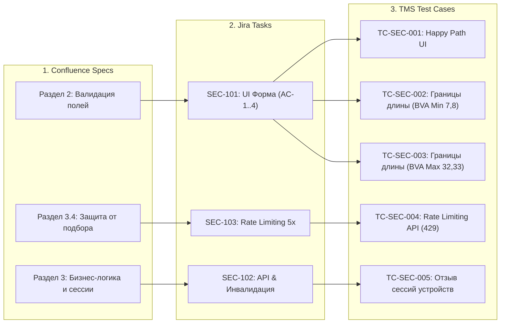

# 📊 Итоговый консолидированный отчет QA-Агента (Final QA Orchestrator Report)

## 1. Общие сведения о прогоне
- **Дата выполнения**: 2026-10-26
- **Анализируемый документ**: Confluence: *"Требования к фиче Смена пароля v1.0"*
- **Статус выполнения пайплайна**: ✅ **SUCCESSFULLY COMPLETED WITH ADAPTIVE ASSUMPTIONS**
- **Итоговый индекс качества требований**: **7.5 / 10**

---

## 2. Результаты прохождения Quality Gates

| Этап | Задействованный навык | Назначение этапа | Статус Quality Gate | Комментарий |
|---|---|---|---|---|
| **Этап 1** | `requirement_review` | Статический анализ требований Confluence | ⚠️ **PASSED WITH WARNINGS** | Выявлено 1 противоречие (длина пароля 8 vs 10) и 3 пробела в безопасности. Зафиксированы допущения. |
| **Этап 2** | `task_design` | Декомпозиция задач для Jira | ✅ **PASSED** | Спроектирован 1 Epic, 1 User Story (4 AC) и 2 технические задачи (Backend API и Rate Limit). |
| **Этап 3** | `test_design` | Проектирование тест-кейсов для TMS | ✅ **PASSED** | Разработано 8 сценариев (Positive, Boundary BVA, Negative EP, Security Rate Limit, Session Invalidation). |

---

## 3. Сводная матрица сквозной трассируемости (End-to-End Traceability Matrix)

---

## 4. Сводный реестр выявленных дефектов и рисков
1. **Противоречие длины пароля (REQ-01, Major)**: Разрешено в пользу 8-32 символов (стандарт NIST/OWASP). Требуется подтверждение аналитика.
2. **Отсутствие лимитов попыток (REQ-03, Major)**: Предложена реализация 5 попыток / 15 минут блокировки для предотвращения компрометации аккаунтов.
3. **Безопасность сессий (REQ-04, Major)**: Добавлена архитектурная задача на инвалидацию токенов в распределенном кэше Redis при смене пароля.

---

## 5. Сформированные артефакты
- 📄 **Ревью требований**: `examples/step1_requirement_review.md`
- 📄 **Задачи Jira**: `examples/step2_jira_tasks.md`
- 📄 **Тест-кейсы TMS**: `examples/step3_test_design.md`

**Рекомендация QA**: Спецификация после внесения предложенных правок готова к взятию в спринт разработки.
